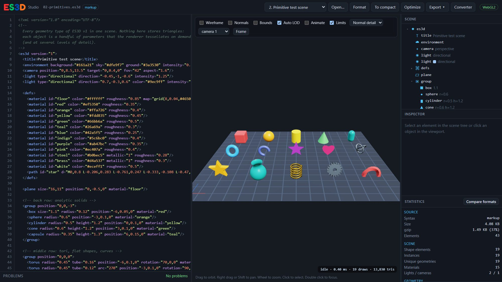
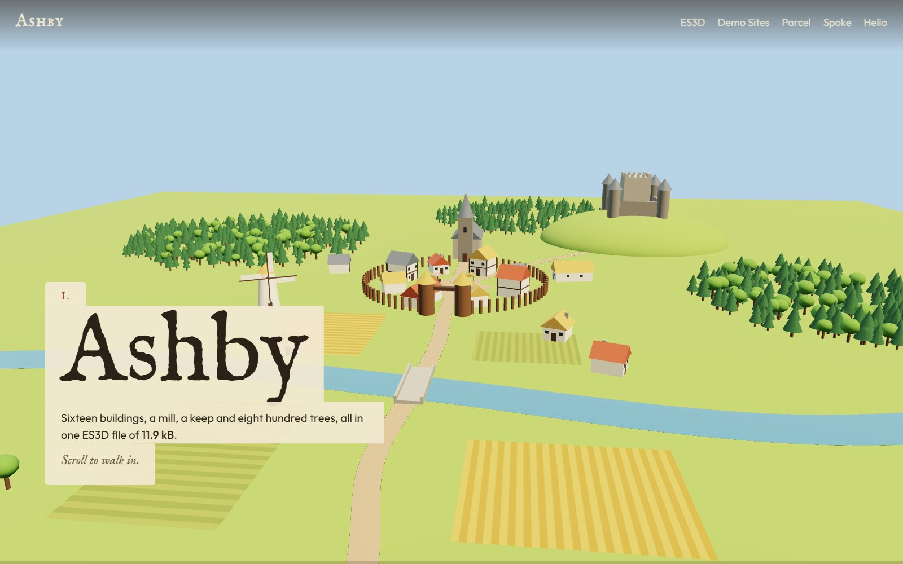
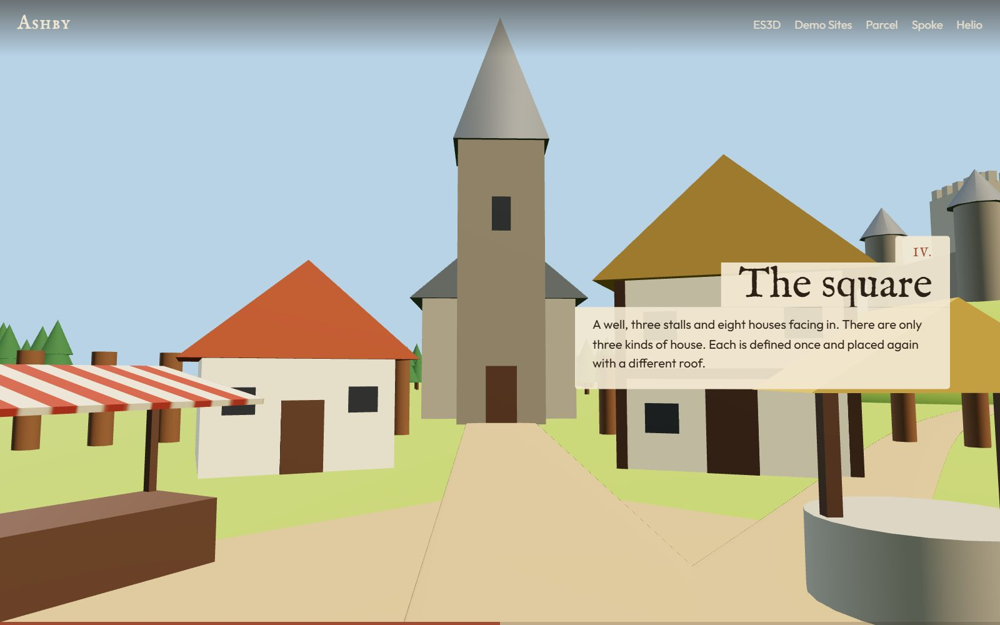
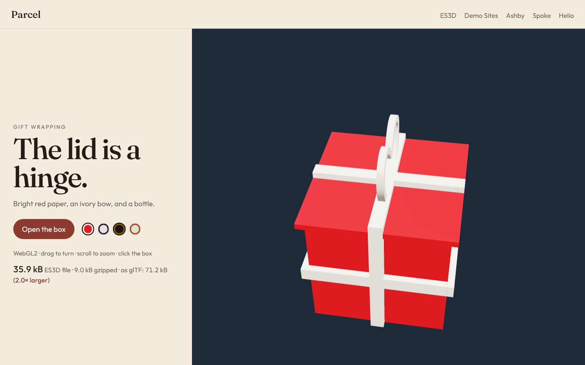
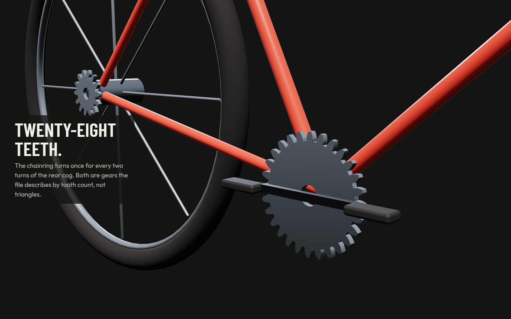
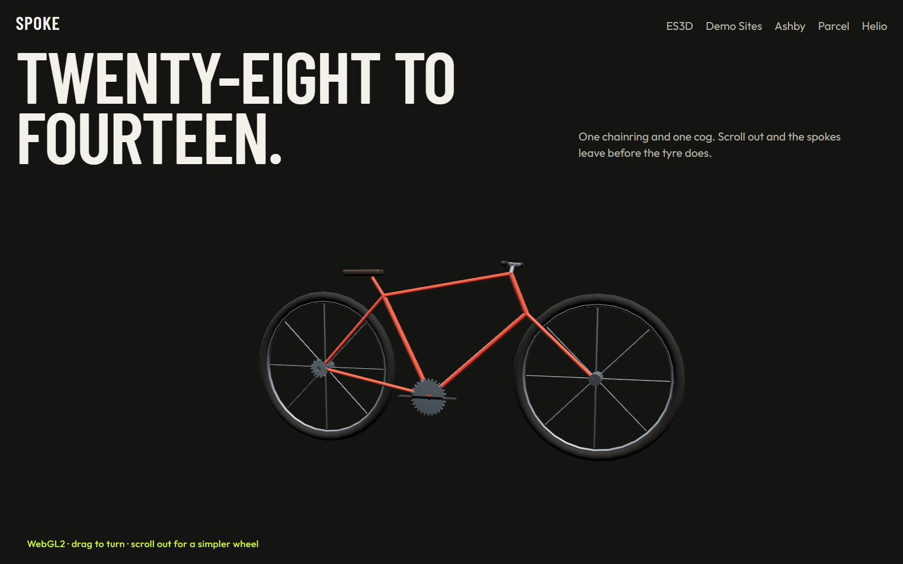
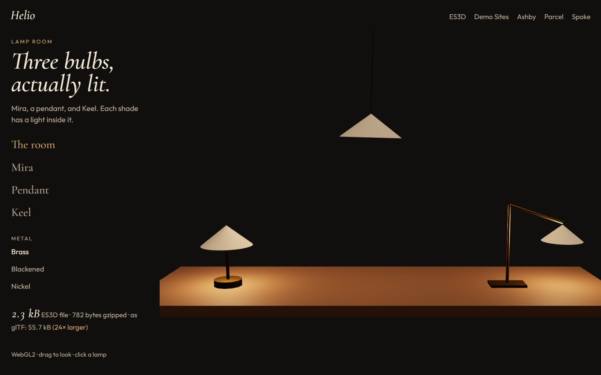
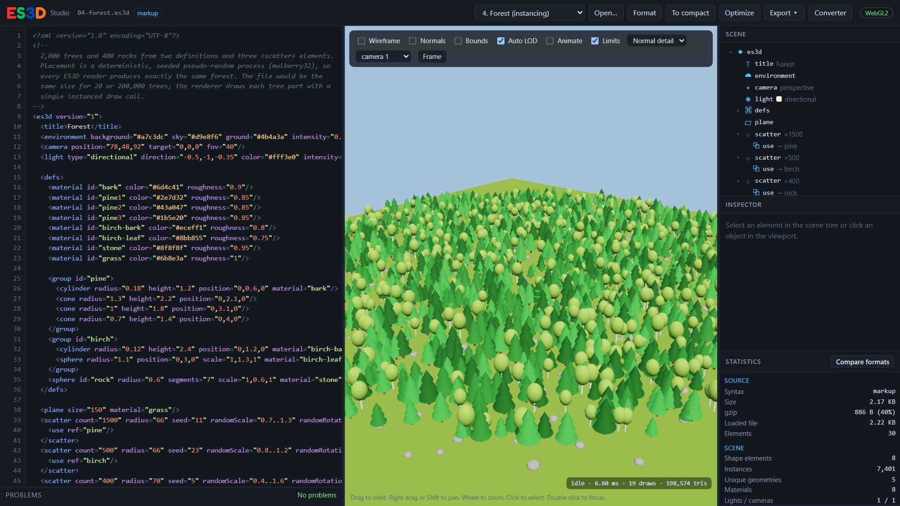
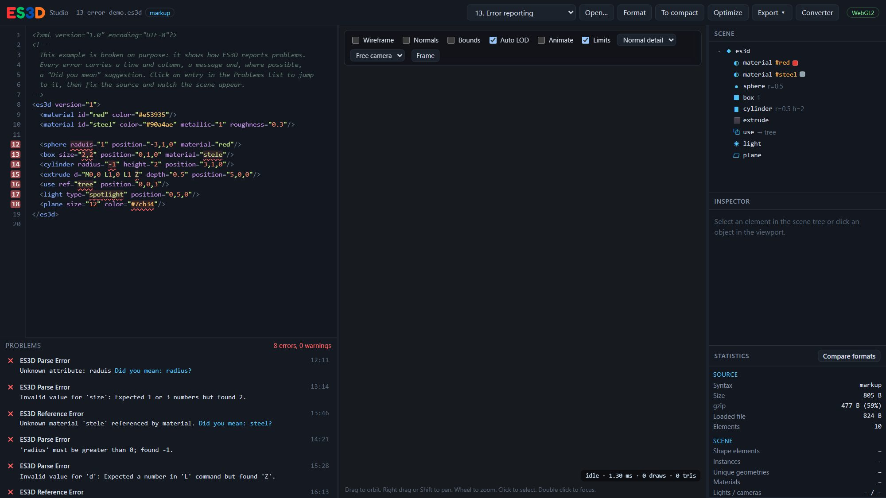

# ES3D: Extensible Scalable 3D

<p align="center">
  <a href="https://www.jsdelivr.com/package/npm/@es3d/es3d"></a>
  <a href="https://www.npmjs.com/package/@es3d/es3d"></a>
  <a href="https://www.npmjs.com/package/@es3d/es3d"></a>
  <a href="https://github.com/bitilia/es3d/stargazers"></a>
  <a href="https://github.com/bitilia/es3d/blob/main/LICENSE"></a>
  <a href="https://nodejs.org/"></a>
</p>

**A declarative, SVG-inspired 3D scene format** (`.es3d`), with a reference implementation: a strict parser and validator, a WebGPU renderer with a WebGL2 fallback, an editor ("ES3D Studio"), a low-poly modeller, a file converter (SVG, OBJ, STL, STEP and glTF to ES3D and back), a command-line tool, and the website for [es3d.org](https://es3d.org).

```xml
<es3d version="1">
  <material id="brass" color="#c9a227" metallic="1" roughness="0.35"/>
  <defs>
    <group id="tree">
      <cylinder radius="0.15" height="1.2" position="0,0.6,0" color="#6d4c41"/>
      <cone radius="1" height="2.4" position="0,2.4,0" color="#2e7d32"/>
    </group>
  </defs>
  <extrude d="M0,0 L2,0 A1,1 0 0,1 2,2 L0,2 Z" depth="0.3" bevel="0.05" material="brass"/>
  <scatter count="2000" radius="60" seed="7" randomScale="0.7..1.3" randomRotation="0,0..360,0">
    <use ref="tree"/>
  </scatter>
</es3d>
```

The same document in the compact syntax:

```
es3d version=1
material#brass c=#c9a227 metallic=1 roughness=.35
defs { group#tree { cylinder r=.15 h=1.2 p=0,.6,0 c=#6d4c41  cone r=1 h=2.4 p=0,2.4,0 c=#2e7d32 } }
extrude d="M0,0 L2,0 A1,1 0 0,1 2,2 L0,2 Z" depth=.3 bevel=.05 m=brass
scatter n=2000 radius=60 seed=7 randomScale=.7..1.3 randomRotation=0,0..360,0 { use @tree }
```

That is a bevelled extruded outline and 2,000 trees (4,001 rendered instances) in 528 bytes of markup or 328 bytes of compact syntax. The renderer tessellates every shape itself, at up to four levels of detail chosen per instance, and draws the 4,000 tree parts with a handful of instanced draw calls (one per part and level of detail).



## Quick start

Requires Node.js 22 or newer.

```bash
npm install
npm run dev          # the website at http://localhost:5173, including the demo sites at /demo/
npm run build        # production build of the whole site into dist/ (static files, relative URLs)
npm run preview      # serve dist/ at http://localhost:4173
npm test             # unit tests (node:test)
```

**Demo Sites:** [`docs/demo/`](docs/demo/) is part of the same site.
- **Ashby** is a fly-through of a medieval village, driven by scroll. You come in over the fields, cross the river, pass through the gate, cross the square, then rise to the church and the keep. The village is one ES3D file of 12 kB (3 kB gzipped) that places 2,472 objects: sixteen buildings, a turning windmill, a palisade and eight hundred trees.
- **Parcel** is a gift box you can open: 13 kB. It came from CAD as STEP, and the converter wrote its parts as ES3D shapes (an extrusion, flat faces and revolves for the bow), not triangles.
- **Spoke** is a bicycle whose gears keep a tooth ratio: 3.8 kB. Below its product view is a scroll tour: the camera follows a path written into the bicycle's ES3D file, one key view per paragraph.
- **Helio** is a lamp room where each bulb is a light: 2.3 kB.

Every demo site states the size of its ES3D file, plain and gzipped, and so do the example gallery and the home page. The numbers are recorded in `docs/site/sizes.json` by `npm run sizes` and written into the pages when the site is built, so nothing is measured in the browser. After changing an example, the logo or a demo scene, run `npm run sizes`; CI fails while the recorded sizes are out of date.

`npm run demo` opens the index page.

<p>
  
  
</p>
<p>
  
  
</p>
<p>
  
  
</p>

Tooling:

```bash
npm run bench                         # file size + load pipeline: ES3D vs OBJ vs GLB  → docs/benchmark-results.md
npm run bench:lan                     # the same scenes, on phones and other computers on the LAN
npm run bench:lan:10                  # ten passes per device; quote the median at /summary
npm run es3d -- validate scene.es3d   # also: fmt, minify, compact, markup, json, optimize, expand,
                                      #       obj, glb, stl, step, import, stats  (npm run es3d -- --help)
npm run es3d -- import logo.svg -o logo.es3d   # SVG, OBJ, STL, STEP or glTF to ES3D
npm run docs:reference                # regenerate docs/REFERENCE.md from the schema
npm run samples                       # the converter's sample files (docs/public/samples/)
npm run thumbnails                    # the example gallery pictures (needs Playwright)
npm run screenshots                   # the pictures in this README, docs/images/ (needs Playwright)
npm run test:render                   # reference-image test: WebGL2 and WebGPU against saved pictures
npm run sizes                         # re-measure the file sizes the site quotes (docs/site/sizes.json)
```

`thumbnails`, `screenshots` and `test:render` use Playwright (`npm i -D playwright && npx playwright install chromium`, already a dev dependency).

## What is in the box

**The format** ([SPEC.md](docs/SPEC.md), [REFERENCE.md](docs/REFERENCE.md))
- Primitives: box (optionally rounded), sphere, cylinder, cone, capsule, plane, torus (partial arcs), line, polyline, polygon, path; `extrude`, `revolve` and `sweep` of SVG path data (`M L H V C S Q T A Z`, fill rules, bevels, rotation-minimising frames, helices); involute `gear`; explicit `mesh` as an escape hatch.
- SVG-style transforms (`translate rotate rotateX/Y/Z scale quat matrix`, composed left to right) plus `position`/`rotation`/`scale`; hierarchical groups; `defs`/`use` reuse; `repeat` (cumulative step transform) and `scatter` (deterministic seeded placement, specified bit-exactly); authored `lod` switches.
- Minimal PBR materials (base colour, metallic, roughness, opacity, emissive, image or procedural texture, normal map) inherited like SVG `fill`; perspective and orthographic cameras that keep their framing on any screen shape (`aspect`, `fit`); directional, point, spot, ambient and hemisphere lights.
- Animation that moves, turns and scales objects and moves cameras (position, target, fov): from/to, key values with key times, or a path walked at constant speed, played by the clock or by page scroll (`timeline="scroll"`). It is not SMIL. SVG specified SMIL, then the major browsers dropped it.
- `<controls>`: how a viewer may move the camera. Orbit with distance, angle and pan limits, collision that stops the camera at surfaces (`collide`), a fixed view, or a camera that follows page scroll.
- Three interchangeable encodings of the same tree: markup (canonical), compact ES3D-C, and JsonML. These are spellings, not profiles. A reader does not get to implement a smaller subset and still call it version 1.
- Strict validation: every error has a line, a column, a code and a "did you mean" suggestion. Repeated warnings that share a code, an element name and a message are shown once, with a count. Input is never repaired in silence.

**The renderer** ([ARCHITECTURE.md](docs/ARCHITECTURE.md)) is written directly against WebGPU (WGSL) and WebGL2 (GLSL), with no 3D framework. Tessellation is lazy. Each curved shape carries a chordal-error bound, and a frame keeps the coarsest level that stays within one pixel. Canonical meshes are shared by all instances. One vertex buffer and one index buffer are shared. Each frame batches into instanced draws, with frustum culling, metallic/roughness GGX shading, MSAA, wireframe, normal and bounding-box overlays, and ray picking.

<p>
  
  
</p>

**ES3D Studio** (`docs/studio/`) is an editor with highlighting and inline diagnostics, a live preview, a scene tree, and an inspector that edits the source text with the smallest possible change, so formatting and comments survive. It also has statistics, a format comparison, drag-and-drop of `.es3d`, `.svg`, `.obj`, `.stl`, `.gltf`, `.glb` and `.gz`, export to every format, markup and compact conversion, and an optimiser. A *Scroll* slider previews scroll timelines, and *Limits* applies the document's `<controls>` to the free camera. URL parameters: `?example=forest`, `?file=url`, `?renderer=webgl2|webgpu`, `?ui=minimal`, `?t=seconds`, `?progress=0..1`.

**The ES3D Modeller** (`docs/modeller/`) builds low-poly models by hand. Type points as x, y, z (or paste a list), pick three or more in order around an outline and make a plane, then paint planes from a palette. Points can be picked and dragged in the 3D view: over the ground, or up and down with Shift, on a snap grid. Every plane is saved as a `<polygon>` placed with `position` and `rotation`, and the planes of one paint share a `<group>` that uses its `<material>`. Nothing is written as a `<mesh>`, and faces with the same outline share one shape. A polygon is flat, so points that are not on one flat plane are split into triangles, and so is a plane that a moved point bends. Every other element of the format can be added too, placed from the picked points: a sphere on a point, a cylinder or a line between two, an extrusion from a flat outline, a revolve around the upright line through the first point, a sweep through several, and groups, repeats, scatters, levels of detail, definitions and uses, lights, cameras, the environment, controls and animations. They appear in an element tree, and an inspector built from the schema edits every attribute, with the validator's messages. Paints are full materials. Opening an `.es3d` file keeps every element and turns its plain polygons back into points and planes. The model has undo, and the browser keeps a copy between visits.

**The converter** (`docs/convert/`, also `es3d import` and the library's `importFiles()` / `exportFormat()`) runs entirely in the browser. SVG drawings become *procedural* ES3D: filled shapes are extruded from their exact path data and strokes become tubes. Script inside an SVG is not executed. OBJ (with MTL), STL and glTF (`.glb`, or `.gltf` with its `.bin`) become `<mesh>` documents with their materials and instancing. STEP solids exported from CAD software (the boundary representation every CAD tool writes) become ES3D shapes, not meshes. A whole part that is one shape is written as that shape: a `<box>`, an `<extrude>` of its exact outline (lines, circular and elliptical arcs, splines, holes), a `<cylinder>`, a `<sphere>`, a `<torus>`, or a `<revolve>` of its profile for a turned part. Any other part is written face by face: a flat face is a `<path>` with exact arcs and holes, and a cylindrical, conical, spherical or toroidal face bounded along its own circles and lines (fillets, hole walls, rounded corners) is a `<revolve>` through the angle it covers. ES3D v1 has no free-form (NURBS) surfaces and no booleans, so a free-form face, or a curved face cut along a curve that is not one of its own circles (the rim of a cross hole), is tessellated from its exact surface into a `<mesh>`; the converter's note counts those faces. A Z-up file is turned Y-up by a rotation on its outer group, so every coordinate stays the CAD tool's own, in the file's unit. Tessellated STEP stays a `<mesh>`. ES3D converts to glTF, OBJ, STL, STEP and the other ES3D encodings, with a 3D preview and size statistics.

**The website** is the static site in `docs/`: a home page whose spinning logo is rendered live from the ES3D file printed below it, the converter, an example gallery, four demo sites, the specification, a media page for papers and posts, and download and FAQ pages. `npm run build` writes it to `dist/`.

**Examples** (`docs/public/examples/`): rotating cube, every primitive, extruded logo, forest (2,400 objects via `scatter`), gearbox (procedural gears, springs, animation), city (7,300 objects), parametric staircases, materials and textures, compact syntax, mesh escape hatch, animated solar system, LOD stress test (20,000 objects), and a deliberately broken document that shows the diagnostics.

## Results in one table

From `npm run bench` (all formats exported from the same compiled scene, so they contain identical triangles; gzip -9 sizes; full tables in [benchmark-results.md](docs/benchmark-results.md)):

| Scene | Triangles | ES3D (min, gz) | GLB + instancing (gz) | OBJ (gz) |
|---|---:|---:|---:|---:|
| Primitive test | 44,936 | 1.2 kB | 654 kB | 653 kB |
| Forest (scatter, 7,401 instances) | 1.94 M | 0.6 kB | 187 kB | 24 MB |
| City (10,926 instances) | 8.7 M | 0.7 kB | 174 kB | (≈ 670 MB raw, not written) |
| Scanned mesh (no structure) | 81,920 | 704 kB | 1.23 MB (744 kB quantized) | 1.31 MB |

ES3D stays small when a scene is built from primitives, paths and repetition. A scan is stored as a mesh, so the file lands near the size of glTF.

The same scenes drawn on real machines (WebGL2, 960×540, median of ten passes; full tables in [benchmark-devices.md](docs/benchmark-devices.md)):

| Scene | PC build, RTX 5060 Ti | Phone, Galaxy S25+, Adreno 830 | Phone, moto g54 5G |
|---|---:|---:|---:|
| Forest, ES3D frame | 1.36 ms | 4.96 ms | 12.6 ms |
| Forest, three.js frame | 8.18 ms | 68.0 ms | 50.7 ms |
| City, ES3D frame | 0.71 ms | 9.28 ms | 11.8 ms |
| City, three.js frame | 10.1 ms | 68.2 ms | 55.5 ms |
| Scan, ES3D ready | 24.4 ms | 37.9 ms | 56.3 ms |
| Scan, instanced three.js ready | 9.70 ms | 17.0 ms | 21.1 ms |

## Putting a scene on a page

`createStage()` puts a document on a canvas and handles what a page needs around it. It draws only when something visible changed and stops while the canvas is scrolled away. It applies the document's `<controls>`, plays clock animations, and drives scroll animations from a section of the page:

```js
import { createStage } from '@es3d/es3d';

const stage = await createStage(document.querySelector('#tour canvas'), { scroll: document.querySelector('#tour') });
stage.show(source); // a new document reuses the geometry of the last one, so a colour swap uploads nothing
```

A camera that follows the page needs nothing else. The path is in the file:

```xml
<camera position="2.3,1.1,4.4" target="0.9,0.55,0" fov="30" aspect="1.5">
  <animate attr="position" values="2.3,1.1,4.4; 1.45,0.6,0.95; 1.4,2.9,10.5" keyTimes="0,0.5,1" smooth="true" timeline="scroll"/>
  <animate attr="target" values="0.9,0.55,0; 0.6,0.4,0.06; 0.9,0.55,0" keyTimes="0,0.5,1" smooth="true" timeline="scroll"/>
</camera>
<controls mode="scroll"/>
```

On the page, `data-es3d-stop="0.5"` on a paragraph inside the section means "be at progress 0.5 when this paragraph is centred". With matching `keyTimes`, each key view lines up with its text. Without stops, progress runs from 0 to 1 as the section scrolls past. The meshes the path needs are built while the browser is idle, so scrolling does not stall on tessellation. With reduced motion, the camera jumps from stop to stop.

For an orbit view, `<controls minDistance="1.2" maxDistance="9" maxPolar="90" collide="true"/>` keeps the camera at a sensible distance, above the floor and outside every object. `collide="false"` on an element lets the camera through it.

## Project layout

```
docs/                      the public site and the documents
  index.html               home page
  convert/, studio/,       each page is a folder with index.html
    examples/, spec/,
    reference/, media/,
    download/, faq/
  site/                    Vite plugin, shared partials, site CSS, page scripts
  public/                  examples, converter samples, gallery pictures, the home page logo
  SPEC.md, REFERENCE.md,   the format documents and the benchmark write-ups
    ARCHITECTURE.md, …
src/format/                tokenizers, parsers, AST, schema, validator, serializers
src/path/                  SVG path parsing, flattening, fill rules, triangulation
src/geometry/              primitive/extrude/revolve/sweep/gear generators, LOD, geometry cache
src/scene/                 scene graph, flattening to an instance table, animation, picking
src/material/              materials and inheritance
src/render/                camera, controls, frame builder (culling/LOD/batching), WebGPU + WebGL2 backends
src/io/                    SVG import; OBJ, STL, STEP and glTF import/export; the converter; compression
src/optimize/              optimiser and procedural expansion
src/ui/                    ES3D Studio
src/bench/                 benchmark scenes
scripts/                   bench, CLI, reference generator, samples, thumbnails,
                           screenshots, render check, pack check
docs/demo/                 demo sites (Parcel, Spoke, Helio, Ashby) that embed the library
test/                      node:test suites; render/reference/ holds the reference images
.github/workflows/         CI, website deployment (GitHub Pages), npm publishing
```

The package entry (`src/index.js`) exposes the pipeline for use as a library: `compile()`, `parse()`, `serialize()`, `createStage()`, `createRenderer()`, `Camera`, `OrbitControls`, `ScrollTimeline`, `raycast()`, the importers, exporters and converter (`importFiles()`, `exportFormat()`, `svgToES3D()`, …) and the optimiser. `npm install @es3d/es3d` installs it together with the `es3d` command.

## Browser support

The renderer uses WebGPU where `navigator.gpu` is available and falls back to WebGL2 everywhere else (`?renderer=webgl2` forces the fallback). Both backends draw the same picture on every device:

- 4× multisampling on both backends. WebGL2 renders into its own multisampled buffer instead of trusting the browser's antialiasing hint.
- An explicit sRGB canvas colour space.
- The same anisotropic filtering level.
- At most 2 device pixels per CSS pixel.
- Levels of detail chosen in CSS pixels, so a phone and a desktop pick the same meshes for the same view.

`renderer.caps` reports what a device actually uses. `npm run test:render` checks the result: it renders reference scenes with both backends and compares them with saved pictures and with each other. On a GeForce, against the software-rendered references, 0.1–0.5% of pixels differed, all on antialiased edges. The textured scene goes to 1.1% because of anisotropic filtering, which no GPU implements identically.

## License

Apache-2.0. See [LICENSE](LICENSE).

## Generative AI Use Disclaimer

Generative AI was used throughout this project including documentation. 
