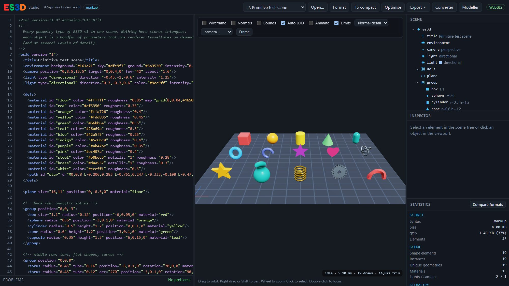
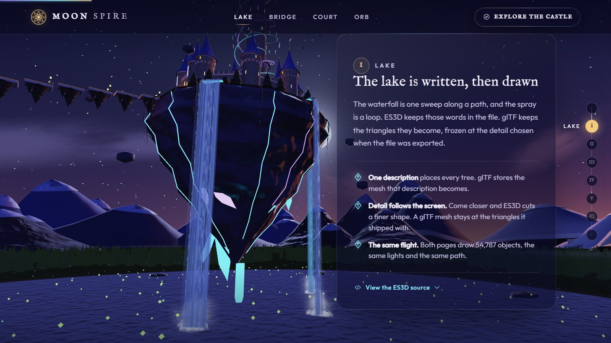
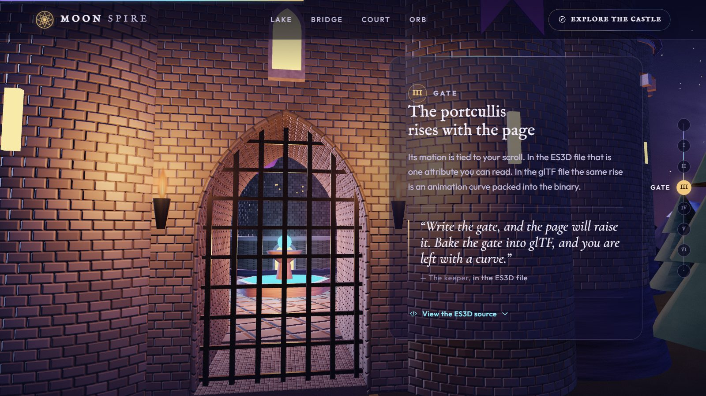
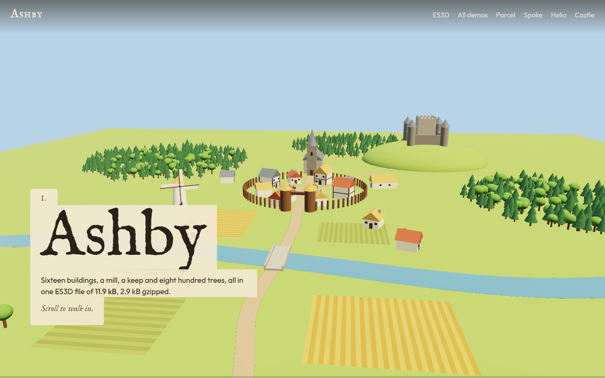
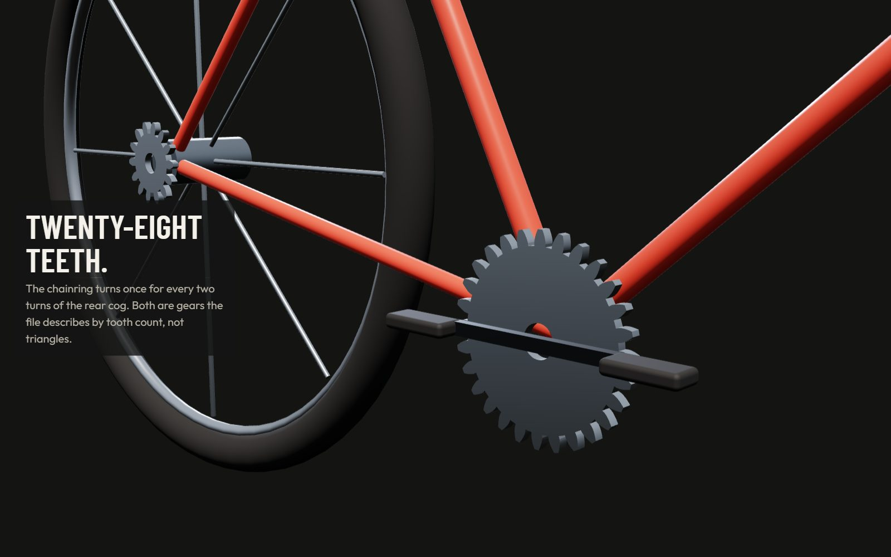

# ES3D: Extensible Scalable 3D

<p align="center">
  <a href="https://www.jsdelivr.com/package/npm/@es3d/es3d"></a>
  <a href="https://www.npmjs.com/package/@es3d/es3d"></a>
  <a href="https://www.npmjs.com/package/@es3d/es3d"></a>
  <a href="https://github.com/bitilia/es3d/stargazers"></a>
  <a href="https://github.com/bitilia/es3d/blob/main/LICENSE"></a>
  <a href="https://nodejs.org/"></a>
</p>

**ES3D is a 3D scene format you can write by hand, the way people write SVG.** A file describes the objects (a rounded box, an outline extruded into a solid, two thousand trees on a hill) and the viewer builds the triangles, at the detail the screen needs. This repository is the reference implementation: parser and validator, a WebGPU/WebGL2 renderer, an editor, a modeller, a file converter, a command-line tool and the website, [es3d.org](https://es3d.org).

```xml
<es3d version="1">
  <defs>
    <group id="tree">
      <cylinder radius="0.15" height="1.2" position="0,0.6,0" color="#6d4c41"/>
      <cone radius="1" height="2.4" position="0,2.4,0" color="#2e7d32"/>
    </group>
  </defs>
  <scatter count="2000" radius="60" seed="7" randomScale="0.7..1.3" randomRotation="0,0..360,0">
    <use ref="tree"/>
  </scatter>
</es3d>
```

That is 2,000 trees in about 400 bytes. The same forest as OBJ is tens of megabytes.



## Use it

```bash
npm install @es3d/es3d
```

```js
import { createStage } from '@es3d/es3d/stage';

const stage = await createStage(document.querySelector('canvas'));
stage.show(source);
```

| Import | What it is |
|---|---|
| `@es3d/es3d` | The whole library as ES modules: compile, render, convert. Node 22+ and bundlers. |
| `@es3d/es3d/browser` | Everything that runs in a browser, in one file, including converting the visitor's files. |
| `@es3d/es3d/stage` | Only the stage, in one smaller file: a document on a canvas, with fragments and a worker. |

The stage is documented in [docs/STAGE.md](docs/STAGE.md), the format in [docs/SPEC.md](docs/SPEC.md) and every element in [docs/REFERENCE.md](docs/REFERENCE.md). The command line: `npx @es3d/es3d --help`.

## Tools

- **[ES3D Studio](https://es3d.org/studio/)**: edit a scene with the 3D view beside it. Errors are located, with a suggestion.
- **[File converter](https://es3d.org/convert/)**: SVG, OBJ, STL, STEP, glTF, X3D, USDA and OpenSCAD to ES3D, and back to most of them. It runs in the browser; nothing is uploaded.
- **[ES3D Modeller](https://es3d.org/modeller/)**: build a low-poly model from points and flat planes.

## Demos

<p>
  
  
</p>
<p>
  
  
</p>

[The demo sites](https://es3d.org/demo/) are built with the library: a castle flight drawn from ES3D or from glTF, a medieval village, a gift box from CAD, a bicycle and a lamp room. Each states the size of its file.

## Results

From `npm run bench`, gzip-compressed, every format holding the same triangles:

| Scene | Triangles | ES3D | glTF (GLB) | OBJ |
|---|---:|---:|---:|---:|
| Forest (7,401 instances) | 1.94 M | 0.6 kB | 187 kB | 24 MB |
| City (10,926 instances) | 8.7 M | 0.7 kB | 174 kB | not written |
| Scanned mesh (no structure) | 81,920 | 704 kB | 744 kB (quantized) | 1.31 MB |

ES3D is smallest when a scene is built from shapes, paths and repetition; a scan stays about the size of glTF. Drawing speed on real devices is in [docs/benchmark-devices.md](docs/benchmark-devices.md), the full size tables in [docs/benchmark-results.md](docs/benchmark-results.md).

## Work on it

```bash
npm install
npm run dev     # the site, Studio, the converter and the demos at http://localhost:5173
npm test        # the unit tests
```

[CONTRIBUTING.md](CONTRIBUTING.md) explains how to report an issue, which checks a pull request runs, and how AI tools may be used. [docs/ARCHITECTURE.md](docs/ARCHITECTURE.md) explains how the code fits together and lists every script.

## License

Apache-2.0. See [LICENSE](LICENSE).

## Generative AI Use Disclaimer

Generative AI was used throughout this project, including documentation, and contributors are welcome to use it too. A person reviewed and is responsible for every change; see [CONTRIBUTING.md](CONTRIBUTING.md#ai-tools-yes-please).
